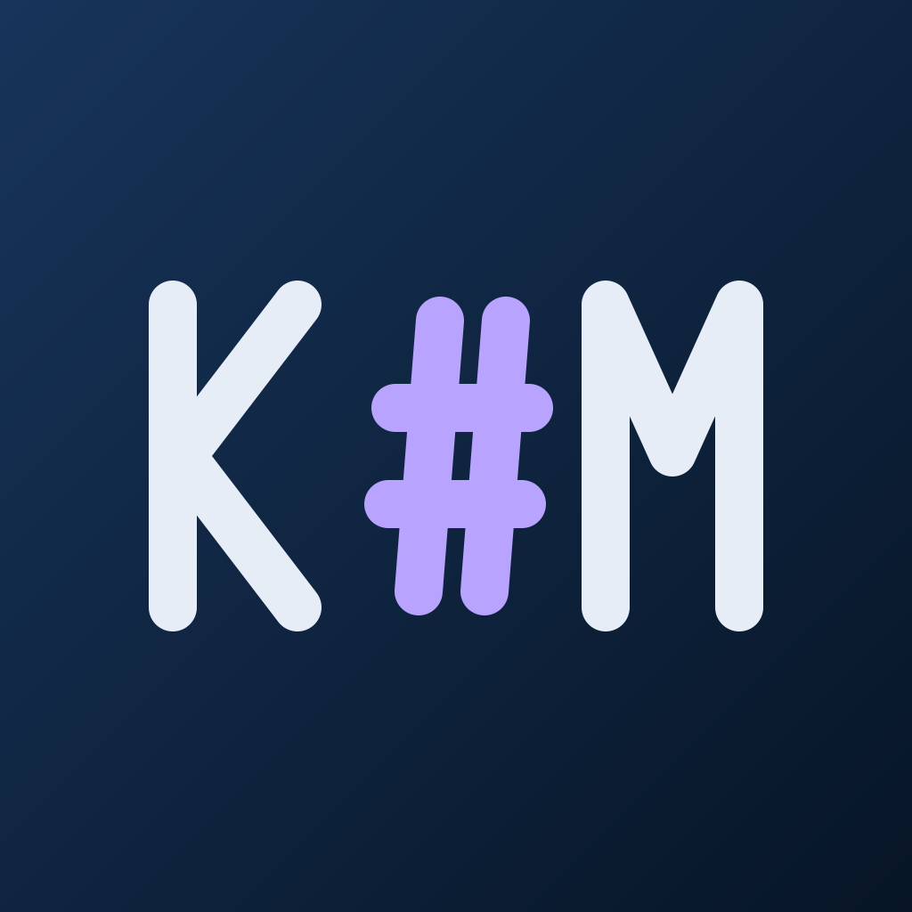
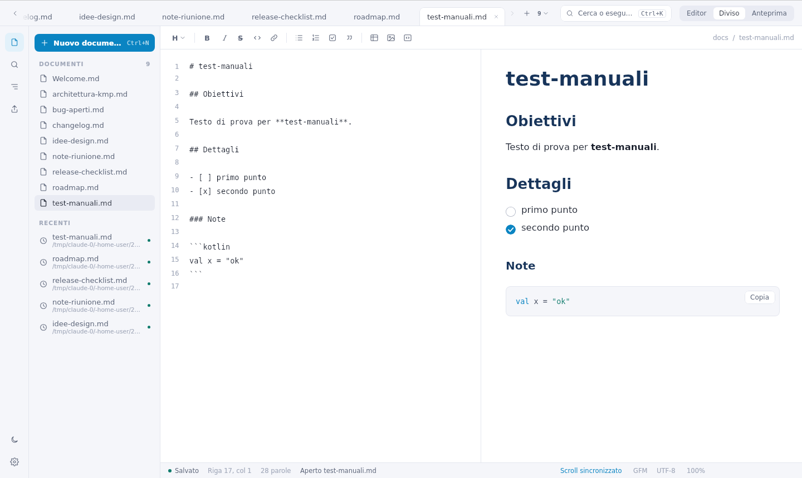
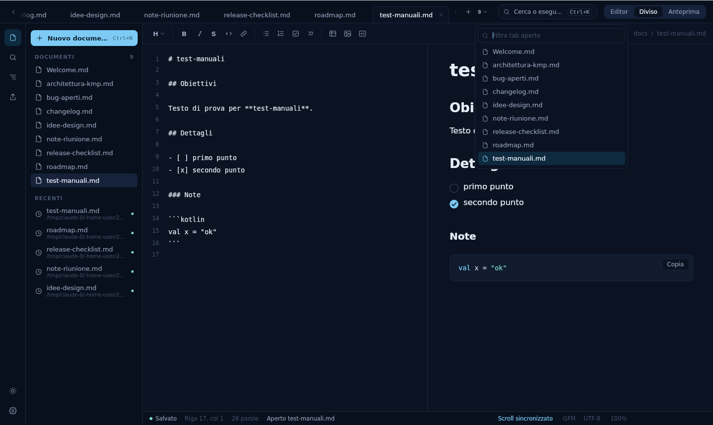
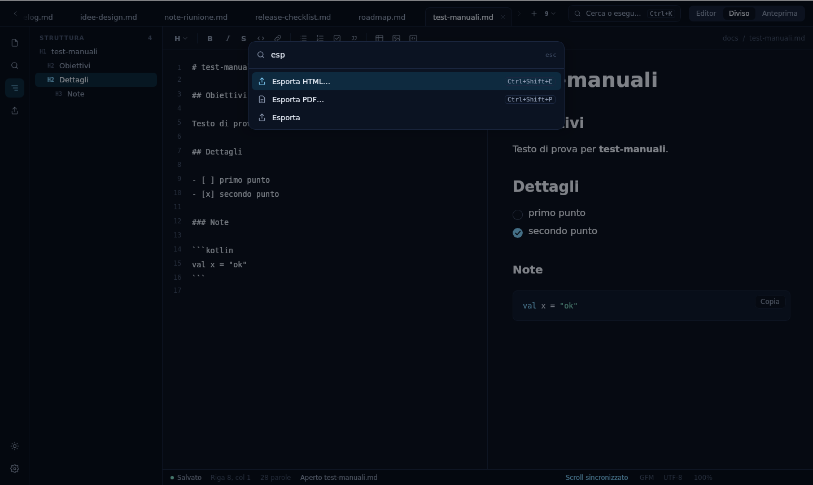
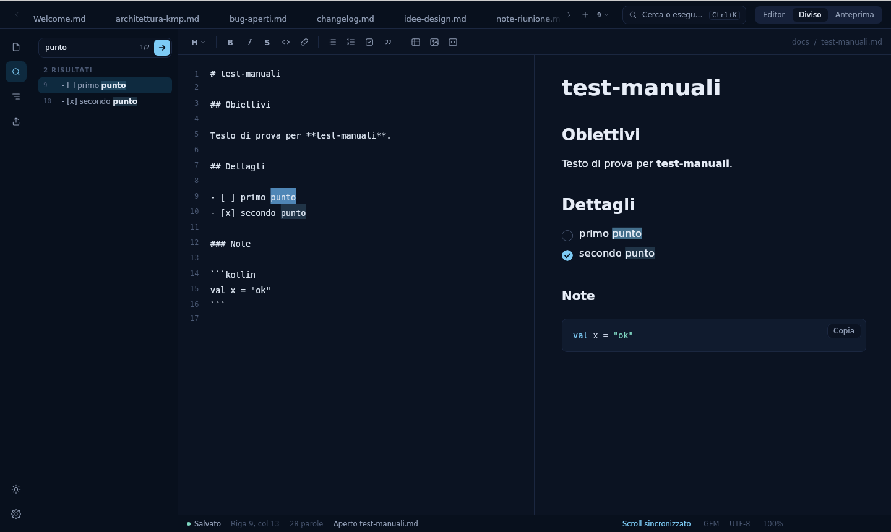
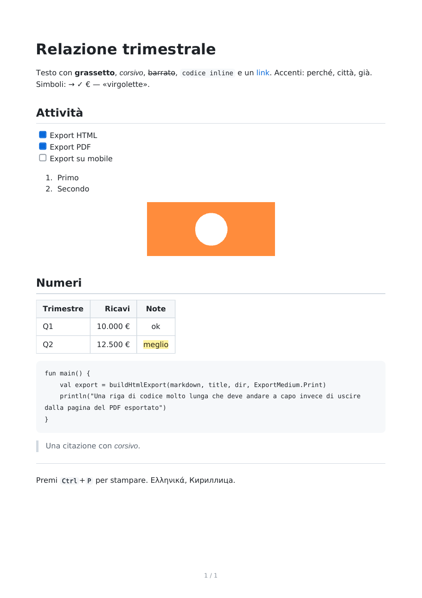

<p align="center">
  
</p>

<h1 align="center">KoMD</h1>

<p align="center">
  A fast, distraction-free <b>Markdown editor</b> with live preview, written in <b>Kotlin</b> with <b>Compose Multiplatform</b>.<br>
  Desktop (macOS, Windows, Linux), Android and iOS from a single shared codebase.
</p>

<p align="center">
  <a href="https://gisourcestudio.com/komd">Website</a> ·
  <a href="#download">Download</a> ·
  <a href="https://gisourcestudio.com/komd/privacy-en.html">Privacy</a>
</p>

<p align="center">
  
  
</p>

---

## Features

### Editing and preview
- **Editor, Split and Preview** modes, with a resizable divider in split view.
- **Live preview** rendered natively in Compose by KoMD's own Markdown parser: headings, bold / italic / strikethrough, inline code, links, block quotes, bullet and numbered lists, GFM **tables** with column alignment, fenced **code blocks with syntax highlighting**, images (also inline).
- **Inline HTML** styles in the preview, e.g. `<mark>`, `<u>`, `<sup>`, `<sub>`, colored `<span>`s.
- **Synchronized scrolling** between editor and preview (toggle from the *View* menu).
- **Clickable task lists**: ticking a `- [ ]` checkbox in the preview updates the source text.
- **Formatting toolbar and shortcuts** for H1–H3, bold, italic, strikethrough, inline code, links, lists, task lists and quotes; quick insert of tables, code blocks, images and custom links.
- **Relative image paths**: an inserted image is stored relative to the `.md` file, and paths are rebased on *Save as* so they keep working when the document moves.
- **Tabs** for multiple open documents, with scrolling tab strip and a tab list menu.
- **Status bar** with line, column, word and character count; zoom in / out / reset.

### Navigation
- **Find in document** (`⌘F` / `Ctrl+F`): matches are highlighted both in the editor and in the rendered preview.
- **Command palette** (`⌘K` / `Ctrl+K`): fuzzy search over every command and its shortcut.
- **Outline panel** with the document's headings, to jump to any section.
- **Recent files** in the sidebar, with a right-click (or long-press) menu to remove an entry or clear the list. Missing files are detected and reported.
- **Tooltips** on every icon button, showing the command name and its shortcut.

### Export
- **HTML**: a standalone page with light/dark CSS; local images are copied into an `images/` folder next to the exported file.
- **PDF** (desktop): A4 pages rendered with OpenHTMLtoPDF from the same HTML pipeline, so the PDF looks like the preview.

### Look and platform integration
- **Ink theme** in light and dark (navy + light blue accent); it follows the system theme at startup and can be toggled at any time.
- **Interface in 5 languages**: Italian, English, French, Spanish, German.
- **Native menu bar** on desktop, generated from the same action list as the toolbar and palette.
- **Open with KoMD** from Finder / Explorer, drag & drop of files onto the window, unsaved-changes guard on exit.

<p align="center">
  
  
  
</p>

## Keyboard shortcuts

`⌘` on macOS / iOS, `Ctrl` on Windows, Linux and Android.

| Action | Shortcut | Action | Shortcut |
|---|---|---|---|
| New document | `⌘N` | Command palette | `⌘K` |
| Open | `⌘O` | Toggle sidebar | `⌘\` |
| Save / Save as | `⌘S` / `⇧⌘S` | Find | `⌘F` |
| Close tab | `⌘W` | Next / previous tab | `⇧⌘]` / `⇧⌘[` |
| Export HTML | `⇧⌘E` | Export PDF (desktop) | `⇧⌘P` |
| Heading 1 / 2 / 3 | `⌘1` / `⌘2` / `⌘3` | Bold / Italic | `⌘B` / `⌘I` |
| Strikethrough | `⇧⌘X` | Inline code | `⌘E` |
| Link | `⌘L` | Zoom in / out / reset | `⌘+` / `⌘-` / `⌘0` |
| Settings | `⌘,` | | |

## Tech stack

| | |
|---|---|
| Language | Kotlin 2.4.21 (Multiplatform) |
| UI | Compose Multiplatform 1.12.2, Material 3 1.12.0-alpha03 |
| Targets | Desktop JVM (macOS, Windows, Linux), Android (min SDK 24, target SDK 37), iOS (arm64 + simulator arm64) |
| File dialogs | [FileKit](https://github.com/vinceglb/FileKit) 0.17.0 |
| Images | [Coil 3](https://coil-kt.github.io/coil/) 3.6.3 with Ktor 3.1.0 (Android, Darwin and Java engines) |
| PDF (desktop) | [OpenHTMLtoPDF](https://github.com/openhtmltopdf/openhtmltopdf) 1.1.117 + [jsoup](https://jsoup.org/) 1.24.1 |
| Build | Gradle 9.6.0, Android Gradle Plugin 9.3.1, JDK 17 |
| Packaging | Compose Desktop `nativeDistributions` (jpackage): `.dmg`, `.msi`, `.deb`; `.msix` for the Microsoft Store |

All versions live in [`gradle/libs.versions.toml`](gradle/libs.versions.toml).

## Architecture

```
komd/
├── shared/       KMP library: all UI, editor state, parser, export (commonMain + platform source sets)
├── desktopApp/   JVM entry point: window, native menu bar, drag & drop, packaging config
├── androidApp/   Android entry point (MainActivity → App())
└── iosApp/       Xcode project; SwiftUI hosts MainViewController() from the Shared framework
```

Almost everything lives in `shared/commonMain`; platform source sets only provide small `expect/actual` pieces (PDF rendering, recent-files storage, shortcut modifier, pointer icons).

**Flow in short**

1. `App()` holds the editor state (open documents, active tab, view mode, search, theme, language).
2. **Single action registry** (`KomdActions.kt`): every command is declared once as a `KomdAction` with label, shortcut, icon, enabled/checked state and handler. The desktop menu bar (`AppCommands.menus` → `DesktopShell`), the format toolbar, the rail, the command palette, the tooltips and the keyboard shortcuts are all projections of that list, so labels and shortcuts never drift between surfaces.
3. **Markdown pipeline**: `parseMarkdown()` (in `MarkdownPreview.kt`) builds a block/inline tree that is rendered by Compose for the preview and by `buildHtmlExport()` for HTML. PDF reuses the HTML output in *print* mode and hands it to `renderPdf()` (OpenHTMLtoPDF on the JVM).
4. **Theme**: `KomdTheme` exposes the Ink light/dark palette (`KomdTheme.colors`) through a `CompositionLocal`; UI strings come from `AppStrings.kt` the same way.
5. **Persistence**: recent files are stored with platform key-value storage (`java.util.prefs`, `SharedPreferences`, `NSUserDefaults`), with FileKit bookmarks to reopen sandboxed files.

Pure logic (search, outline, formatting, task toggle, image paths, HTML export, recent files, shortcuts) is covered by unit tests in `shared/src/commonTest` and `desktopTest`.

## Build and run

Requirements: JDK 17, Android SDK for Android, macOS + Xcode for iOS.

```bash
./gradlew :desktopApp:run                 # desktop app
./gradlew :androidApp:installDebug        # Android, on a connected device or emulator
./gradlew :shared:desktopTest             # unit tests (JVM)
```

For iOS, open `iosApp/iosApp.xcodeproj` in Xcode and run the `iosApp` scheme. You can also open the project root in Android Studio / IntelliJ and use the `androidApp` and `desktopApp` run configurations.

## Packaging

Each installer has to be built on its own OS (jpackage does not cross-compile):

```bash
./gradlew :desktopApp:packageDmg      # macOS  → installer/KoMD-1.0.0.dmg
./gradlew :desktopApp:packageMsi      # Windows → installer/KoMD-1.0.0.msi
./gradlew :desktopApp:packageDeb      # Linux  → installer/komd_1.0.0_amd64.deb (needs fakeroot)
./gradlew :desktopApp:packageDistributionForCurrentOS
```

Installers are copied flat into `installer/` (ignored by git) after every `package*` task.

The **Installers** workflow (`.github/workflows/installers.yml`) is started by hand from the GitHub *Actions* tab and builds all formats on GitHub-hosted runners:

- **macOS**: `.dmg` signed with a Developer ID certificate and notarized by Apple, when the `MACOS_*` and `NOTARIZATION_*` secrets are set (unsigned otherwise);
- **Windows**: `.msi`, plus an `.msix` for the Microsoft Store (`desktopApp/msix/pack-msix.ps1`) when the `MSIX_*` variables are set;
- **Linux**: `.deb`.

The required secrets and variables are documented at the top of the workflow file.

## Download

KoMD is free. Get the latest installers from the [website](https://gisourcestudio.com/komd):

- macOS: [`KoMD-1.0.0.dmg`](https://gisourcestudio.com/komd/KoMD-1.0.0.dmg) (signed and notarized)
- Windows: [`KoMD-1.0.0.msi`](https://gisourcestudio.com/komd/KoMD-1.0.0.msi)
- Linux: [`KoMD-1.0.0.deb`](https://gisourcestudio.com/komd/KoMD-1.0.0.deb)

## Privacy

KoMD works entirely offline on your files: no account, no analytics, no tracking. Network access is used only to load remote images referenced in your documents. See the [privacy policy](https://gisourcestudio.com/komd/privacy-en.html).

## License

_License to be defined._ <!-- TODO: add the license chosen for KoMD (e.g. GPL-3.0) and a LICENSE file. -->

© 2026 Giuseppe Sorce
